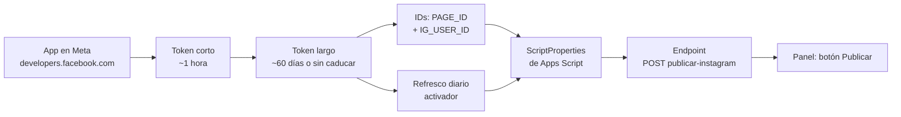

# Guía paso a paso: token de Instagram y publicación real

> **Objetivo**: conseguir el token de acceso a la API de Instagram, guardarlo donde toca
> y dejar el refresco automático montado, para que la pantalla *Redes Sociales* del panel
> publique de verdad (hoy está en modo simulado).
>
> **Fecha de la guía**: 2026-09-30 · API Graph **v26.0** (si Meta la retira, cámbiala en las URLs).
> **Nivel**: sin *App Review* — solo publicáis vosotros desde vuestro panel.

---

## Cómo leer esta guía

Cada paso lleva su pantalla. **Las capturas hay que añadirlas tú** (no puedo fotografiar
el panel de Meta desde aquí). Donde veas `📸`, crea la imagen con ese nombre en
`docs/img/` y descomendra la línea `![...]` justo debajo. Al final queda la lista de
capturas pendientes.



---

## Fase 0 — Requisitos previos

| # | Requisito | Comprobar en |
|---|---|---|
| 0.1 | Cuenta de Instagram **profesional** (Empresa o Creador) | App de IG → Perfil → Tipo de cuenta. Si es personal: Cambiar tipo de cuenta |
| 0.2 | Una **Página de Facebook** del refugio (se crea en [facebook.com/pages](https://www.facebook.com/pages/)) | — |
| 0.3 | IG **vinculado a esa Página**: Página → Ajustes → **Instagram → Conectar** | debe aparecer «Conectado» con el @ de la cuenta |
| 0.4 | Cuenta de Facebook **con permiso de administrador** en esa Página | Página → Ajustes → Roles de la página |
| 0.5 | Cuenta de desarrollador en [developers.facebook.com](https://developers.facebook.com/) | botón *Get Started* arriba a la derecha |

> 📸 Captura `docs/img/ig-00-conexion-pagina.png` → Ajustes de la Página → Instagram, con el «Conectado» a la vista.
>
> ```markdown
> 
> ```

---

## Fase 1 — Crear la app de Meta

1. Ve a [developers.facebook.com/apps](https://developers.facebook.com/apps) → **Crear app**.
2. En *¿Para qué usarás la app?* elige **Empresa** (Business) → Siguiente.
3. Nombre de la app (p. ej. `GN-Encuestas-Instagram`) → **Crear app** (te pedirá tu contraseña de FB).

   > 📸 `docs/img/ig-01-create-app.png` — el formulario de *Crear app* con *Empresa* seleccionado.

4. En el panel de la app: **Añadir producto** → **Instagram Graph API** → **Añadir** (también puedes añadir *Facebook Login*, pero para esta guía no hace falta: el token lo sacamos a mano).

   > 📸 `docs/img/ig-02-producto-instagram.png` — la lista de productos con *Instagram Graph API* en proceso de añadirse.

5. **Ajustes de la app → Básico**: copia **App ID** y pulsa **Mostrar** en **App Secret** → guárdalos en un gestor de contraseñas.

   > 📸 `docs/img/ig-03-app-id-secret.png` — Ajustes básicos con App ID visible y App Secret revelado.

6. **Modo de la app = Desarrollo** (viene así por defecto y así debe quedar): en este modo **solo publican los roles de la app** (tú), lo cual es exactamente lo que necesitáis. No hace falta publicar la app ni pasar revisión.

---

## Fase 2 — Token de acceso (corto → largo)

### 2.1 Token corto (dura ~1 hora)

1. Abre [developers.facebook.com/tools/explorer](https://developers.facebook.com/tools/explorer/) (**Graph API Explorer**).
2. En el desplegable **Aplicación**, elige tu app (`GN-Encuestas-Instagram`).
3. En **Permisos** añade exactamente:
   `instagram_basic` · `instagram_content_publish` · `pages_read_engagement` · `pages_show_list`
4. Botón **Generar token de acceso** → te avisa de que los permisos están en *desarrollo* → acepta.
5. En la ventana de cuentas, **marca la cuenta de Instagram profesional** asociada a tu Página → Continuar → Aceptar.

   > 📸 `docs/img/ig-04-explorer-permisos.png` — Explorer con la app seleccionada y los 4 permisos en la lista.
   > 📸 `docs/img/ig-05-explorer-cuenta.png` — el popup de cuentas con la casilla de la cuenta profesional marcada.

6. Copia el token (botón *Generate access token* → copia el valor largo). **Caduca en ~1 h: usa ya el paso 2.2.**

### 2.2 Cambiarlo a token largo

Pega esta URL en el navegador (sustituye los tres huecos) — lo devuelve en JSON:

```
https://graph.facebook.com/v26.0/oauth/access_token
  ?grant_type=fb_exchange_token
  &client_id={TU_APP_ID}
  &client_secret={TU_APP_SECRET}
  &fb_exchange_token={TOKEN_CORTO}
```

Respuesta: `{"access_token":"EAAG...","token_type":"bearer","expires_in":5184000}` → **5184000 s = 60 días**. Copia ese `access_token`.

### 2.3 Verificar el token (obligatorio)

```
https://graph.facebook.com/v26.0/debug_token
  ?input_token={TU_TOKEN_LARGO}
  &access_token={TU_APP_ID}|{TU_APP_SECRET}
```

Mira tres cosas de la respuesta:

| Campo | Qué esperar |
|---|---|
| `is_valid` | `true` |
| `scopes` | debe contener los 4 permisos (`instagram_basic`, `instagram_content_publish`, `pages_read_engagement`, `pages_show_list`) |
| `expires_at` | marca de tiempo Unix de caducidad → **0 = nunca caduca** (típico mientras la app esté en *Desarrollo* y tú tengas rol). Si es 0, el refresco de la Fase 4 es «por si acaso» |

> 📸 `docs/img/ig-06-debug-token.png` — la respuesta de `debug_token` con `is_valid`, `scopes` y `expires_at`.

---

## Fase 3 — Los dos IDs que necesitas

Usa el token largo como `access_token` en las dos llamadas.

**1) ID de la Página**

```
https://graph.facebook.com/v26.0/me/accounts?access_token={TU_TOKEN_LARGO}
```
→ en `data[0].id` tienes el **PAGE_ID** (y ahí mismo un `access_token` de Página, no lo necesitas).

**2) ID de Instagram (el que se usa para publicar)**

```
https://graph.facebook.com/v26.0/{PAGE_ID}?fields=instagram_business_account&access_token={TU_TOKEN_LARGO}
```
→ `instagram_business_account.id` = **IG_USER_ID**.

Si esta segunda llamada da error o `instagram_business_account` sale vacío: la cuenta profesional **no está vinculada a la Página** → vuelve al punto 0.3.

> 📸 `docs/img/ig-07-ids.png` — las dos respuestas JSON resaltando `PAGE_ID` e `instagram_business_account.id`.

---

## Fase 4 — Guardarlo todo en Apps Script (`ScriptProperties`)

**Nada de esto puede ir en `.env` ni en el código**: `gen-config.js` escribe `src/js/config.js`, que se publica en GitHub Pages (repo público). El token y el *App Secret* solo viven en las propiedades del script.

1. Abre tu proyecto de Apps Script (el backend) → **Configuración** (icono de engranaje, esquina superior) → sección **Propiedades del script** → **Añadir propiedad**.
2. Añade estas claves:

| Clave | Valor |
|---|---|
| `IG_APP_ID` | App ID de la Fase 1 |
| `IG_APP_SECRET` | App Secret de la Fase 1 |
| `IG_ACCESS_TOKEN` | token largo de la 2.2 |
| `IG_PAGE_ID` | PAGE_ID de la Fase 3 |
| `IG_USER_ID` | IG_USER_ID de la Fase 3 |

   > 📸 `docs/img/ig-08-script-properties.png` — la tabla de *Propiedades del script* con las 5 claves añadidas (valores ocultos o recortados).

3. **Nunca** las copies a `.env`, a `Config.gs` ni al front. `APP_ID`/`PAGE_ID`/`IG_USER_ID` no son secretos (podrían ir en `.env`), pero tenerlos todos juntos aquí evita manejos a medias.

---

## Fase 5 — Prueba de publicación (a mano, antes de tocar código)

En una terminal (PowerShell o curl), tres llamadas:

**5.1 Crear el contenedor** (la imagen debe estar en **URL pública y accesible sin login**)

```bash
curl -X POST "https://graph.facebook.com/v26.0/{IG_USER_ID}/media" `
  -d "image_url=https://.../foto.jpg" `
  -d "caption=Prueba desde la API #GrupoNebak" `
  -d "access_token={TU_TOKEN_LARGO}"
```
→ `{"id":"17841400000000000"}` = `creation_id`.

**5.2 Esperar a que esté listo** (5-30 s para fotos)

```bash
curl "https://graph.facebook.com/v26.0/{CREATION_ID}?fields=status_code&access_token={TU_TOKEN_LARGO}"
```
→ `{"status_code":"FINISHED"}`. Si dice `IN_PROGRESS`, repite; `ERROR`/`EXPIRED` → ver tabla de errores.

**5.3 Publicar**

```bash
curl -X POST "https://graph.facebook.com/v26.0/{IG_USER_ID}/media_publish" `
  -d "creation_id={CREATION_ID}" `
  -d "access_token={TU_TOKEN_LARGO}"
```
→ `{"id":"{MEDIA_ID}"}`. Comprueba en el perfil de IG.

**5.4 Enlace del post** (para el historial del panel):

```bash
curl "https://graph.facebook.com/v26.0/{MEDIA_ID}?fields=permalink&access_token={TU_TOKEN_LARGO}"
```

> 📸 `docs/img/ig-09-post-publicado.png` — el post visible en el perfil + la respuesta de `media_publish`.

**Límites a recordar**: ~50-100 publicaciones por 24 h y cuenta · caption ≤ 2200 caracteres · ≤ 30 hashtags · imagen JPEG 320-1440 px de ancho · el contenedor caduca a las 24 h.

---

## Fase 6 — Refresco del token

Solo es necesario si `expires_at` de la 2.3 **no** es 0. Se refresca igual que en la 2.2, pero con el token actual en `fb_exchange_token`.

### 6.1 Función en `Code.gs` (backend, no versionado)

```js
/** Refresca el token de Instagram y lo vuelve a guardar. Devuelve true si ok. */
function igRefrescarToken(force) {
  const props = PropertiesService.getScriptProperties();
  const long = props.getProperty('IG_ACCESS_TOKEN');
  if (!long) return false;
  // Si queda más de 7 días y no se fuerza, no hacemos nada.
  const info = igDebugToken();
  if (!force && info && info.expires_at && info.expires_at * 1000 - Date.now() > 7 * 86400000) return true;
  const url = 'https://graph.facebook.com/v26.0/oauth/access_token'
    + '?grant_type=fb_exchange_token'
    + '&client_id=' + encodeURIComponent(props.getProperty('IG_APP_ID'))
    + '&client_secret=' + encodeURIComponent(props.getProperty('IG_APP_SECRET'))
    + '&fb_exchange_token=' + encodeURIComponent(long);
  const res = JSON.parse(UrlFetchApp.fetch(url, { muteHttpExceptions: true }));
  if (!res.access_token) throw new Error('No se pudo refrescar el token: ' + JSON.stringify(res));
  props.setProperty('IG_ACCESS_TOKEN', res.access_token);
  return true;
}

function igDebugToken() {
  const p = PropertiesService.getScriptProperties();
  const url = 'https://graph.facebook.com/v26.0/debug_token'
    + '?input_token=' + encodeURIComponent(p.getProperty('IG_ACCESS_TOKEN'))
    + '&access_token=' + encodeURIComponent(p.getProperty('IG_APP_ID') + '|' + p.getProperty('IG_APP_SECRET'));
  return JSON.parse(UrlFetchApp.fetch(url, { muteHttpExceptions: true }));
}
```

### 6.2 Activador diario

1. En el editor de Apps Script → **Activadores** (icono de reloj, columna izquierda) → **Añadir activador**.
2. Función: `igRefrescarToken` · Origen: **basado en tiempo** · Tipo: **diario** · Hora: 06:00-07:00 → **Guardar**.

   > 📸 `docs/img/ig-10-activador.png` — el formulario del activador diario.

### 6.3 Refresco de emergencia desde el código de publicación

Además del activador, en el endpoint de publicación: si Graph devuelve error **`(#190)` / `OAuthException`** → llama a `igRefrescarToken(true)` y **reintenta una sola vez**. Así el panel se auto-repara aunque el activador no haya corrido.

---

## Fase 7 — Integración en el panel (lo que haré yo al implementar)

1. `Code.gs`: endpoint **`POST publicar-instagram`** que recibe `{ image_url, caption }`, hace el flujo 5.1-5.4 con los `ScriptProperties` y devuelve `{ permalink, media_id, estado }` — patrón idéntico al resto (`Content-Type: text/plain`, respuesta con `status`).
2. `api.js`: `API.publicarInstagram(data)` con el `_post` genérico existente.
3. `dashboard.js`: sustituir el corte previsto en `dashboard.js:1699` — `_pushPublicacion` pasa a llamar a la API (hoja `Publicaciones` como fuente) y `publicarRedes()` deja de marcar `estado: 'simulado'` (estados `pendiente → publicado | error` con `permalink` real).
4. Foto: `_fotoSrc` devuelve `drive.google.com/thumbnail?id=…` → debe ser accesible sin login; si no, servirla desde Pages o usar `https://drive.google.com/uc?export=view&id=…`.
5. Actualizar aviso «Modo simulado» (`renderRedes`) y tutorial `_tutorialRedes`.
6. Tests de las funciones puras (payload y mapeo de estados) + subir `CACHE_NAME` en `src/sw.js`.

---

## Errores típicos

| Mensaje | Causa | Solución |
|---|---|---|
| `(#10) Permission denied` | Falta un permiso o no tienes rol en la app | Repetir 2.1 con los 4 permisos; ser admin de la app |
| `(#190) error retrieving access token` / `token has expired` | Token caducado | `igRefrescarToken(true)` o repetir Fase 2 |
| `(#100) Invalid param` en `image_url` | Meta no puede descargar la imagen | URL pública sin login; probar con `curl -I`; JPEG 320-1440 px |
| `unsupported post request` en `/media_publish` | `IG_USER_ID` incorrecto o cuenta no profesional/vinculada | Repetir Fase 3 |
| `status_code: ERROR` en el contenedor | Imagen inválida o URL caída | mirar `error_subcode`; reintentar con otra URL |
| `status_code: EXPIRED` | Pasaron más de 24 h desde crear el contenedor | crear uno nuevo |
| Fallo solo al publicar con Página | La Página exige **Page Publishing Authorization** o 2FA | completar la autorización en la Página / activar 2FA en la cuenta FB |
| Límite de publicaciones | >50-100 posts en 24 h | esperar; controlar en el panel |

---

## Checklist final «todo bien configurado»

- [ ] IG es cuenta **profesional** y **vinculada a la Página** (0.3)
- [ ] App creada, producto **Instagram Graph API** añadido, modo **Desarrollo** (Fase 1)
- [ ] **App ID + App Secret** guardados fuera del repo
- [ ] Token largo obtenido y **`debug_token`** con `is_valid:true`, 4 `scopes` y `expires_at` anotado (2.3)
- [ ] **PAGE_ID** e **IG_USER_ID** guardados
- [ ] Las **5 claves** en `ScriptProperties` de Apps Script (Fase 4)
- [ ] Publicación de prueba hecha a mano con permalink real (Fase 5)
- [ ] `igRefrescarToken` + **activador diario** creados (solo si `expires_at ≠ 0`)
- [ ] (Al implementar) endpoint `publicar-instagram` + corte del front + tests + `CACHE_NAME`

## Capturas pendientes

- [ ] `docs/img/ig-00-conexion-pagina.png`
- [ ] `docs/img/ig-01-create-app.png`
- [ ] `docs/img/ig-02-producto-instagram.png`
- [ ] `docs/img/ig-03-app-id-secret.png`
- [ ] `docs/img/ig-04-explorer-permisos.png`
- [ ] `docs/img/ig-05-explorer-cuenta.png`
- [ ] `docs/img/ig-06-debug-token.png`
- [ ] `docs/img/ig-07-ids.png`
- [ ] `docs/img/ig-08-script-properties.png`
- [ ] `docs/img/ig-09-post-publicado.png`
- [ ] `docs/img/ig-10-activador.png`

## Referencias oficiales

- Content Publishing: `https://developers.facebook.com/docs/instagram-platform/instagram-api-with-facebook-login/content-publishing/`
- `IG User · media`: `https://developers.facebook.com/docs/instagram-platform/instagram-graph-api/reference/ig-user/media/`
- `IG User · media_publish`: `https://developers.facebook.com/docs/instagram-platform/instagram-graph-api/reference/ig-user/media_publish/`
- Exchange de token: `https://developers.facebook.com/docs/graph-api/reference/v26.0/oauth/access_token`
- Debug de token: `https://developers.facebook.com/docs/graph-api/reference/debug_token`
